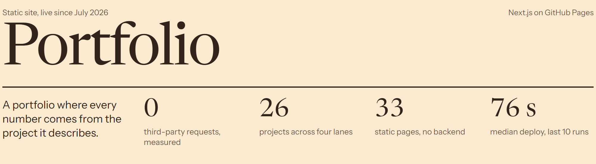
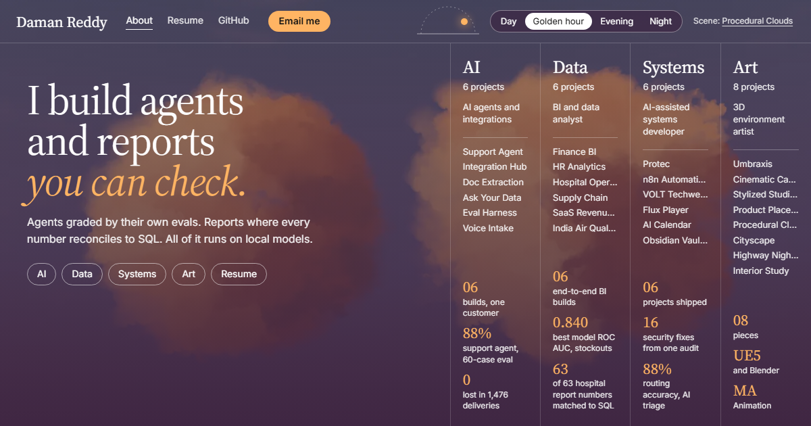

<picture>
  <source media="(max-width: 600px) and (prefers-color-scheme: dark)" srcset=".github/assets/header-phone-dark.png">
  <source media="(max-width: 600px) and (prefers-color-scheme: light)" srcset=".github/assets/header-phone-light.png">
  <source media="(prefers-color-scheme: dark)" srcset=".github/assets/header-dark.png">
  <source media="(prefers-color-scheme: light)" srcset=".github/assets/header-light.png">
  
</picture>

Daman Reddy's portfolio: AI agents and integrations, BI and data, AI-assisted systems, and 3D environment art. It is a Next.js 16 static export on GitHub Pages, with every project, metric and pipeline card kept in one content file. It exists so each project can be judged on measured numbers rather than adjectives.

[Live site](https://damanjz.github.io/portfolio/) · [](https://github.com/damanjz/portfolio/actions/workflows/deploy.yml)

## Results

| Figure | Result | How it is produced |
|---|---|---|
| Third-party requests | 0 | Headless Chromium on the live site, 2026-11-13: load and full scroll of `/`, `/ai/`, `/data/`, `/projects/fde-support-agent/`, `/projects/umbraxis/` and `/resume/`; all 506 requests went to `damanjz.github.io` (browser resource timing) |
| Projects | 26, across four lanes | The `projects` array in `src/content.ts`: AI 6, Data 6, Systems 6, Art 8 |
| Static pages | 33 | `<loc>` entries in the live [sitemap.xml](https://damanjz.github.io/portfolio/sitemap.xml), 2026-11-13; no backend, no database |
| Deploy time | 76 s median (75.5 s), range 46 to 116 s | The last 10 `deploy.yml` runs on `main`, 2026-10-12 to 2026-11-13, start to finish, from the GitHub Actions API |

## How it works

| Layer | Choice |
|---|---|
| Content | All copy, projects, metrics and pipeline cards live in `src/content.ts`; components only lay it out |
| Framework | Next.js 16 (App Router), React 19, TypeScript, static export (`output: "export"`) |
| Frame | One client component (`src/components/Shell.tsx`): the scene, the time-of-day dial and five columns; the page you are on is the open column |
| Styling | Plain CSS (`src/app/globals.css`, `pipe.css`); four times of day are registered colour properties that fade together; no Tailwind, no animation library |
| Type | Newsreader for display, Instrument Sans for text, self-hosted at build time via `next/font` |
| Images | Committed WebP with 400, 800 and 1400 px copies and a srcset manifest (`scripts/sizes.mjs`) |
| Deploy | Pushing to `main` runs `.github/workflows/deploy.yml`, which builds and publishes to GitHub Pages under the `/portfolio` base path (`NEXT_PUBLIC_BASE_PATH`) |

## Pages



- **Home (`/`)**: five columns in front of a scene from Daman's own renders. The open column holds the heading, featured work and About (story, skills, timeline). The other four are the lanes, each with its projects and three numbers. A dial switches the scene between day, golden hour, evening and night, chosen by the time in Hyderabad and moving on every minute until you pick one.
- **Lanes**: [`/ai/`](https://damanjz.github.io/portfolio/ai/), [`/data/`](https://damanjz.github.io/portfolio/data/), [`/systems/`](https://damanjz.github.io/portfolio/systems/), [`/art/`](https://damanjz.github.io/portfolio/art/): the pitch, the numbers, how the work is done, then every project as a row.
- **Project pages**: `/projects/<slug>/`: the result, the build, decisions, facts, then pictures and reels; links to source, live dashboards and case-study PDFs.
- **Resume** ([`/resume/`](https://damanjz.github.io/portfolio/resume/)) with a PDF download, **Privacy** ([`/privacy/`](https://damanjz.github.io/portfolio/privacy/)), and a custom 404.

Data and software projects without a strong screenshot are drawn as a pipeline card instead: what goes in, the core, what comes out, and four measured numbers. Cards sit in black and white and come to colour on hover.

## Principles

- **Zero external requests.** Fonts are self-hosted, images are committed, reels are self-hosted, and YouTube (nocookie) loads only when you press play.
- **Static and local-first.** No backend, no database, no cookies, no analytics.
- **Real metrics only.** Every number on the site comes from the project it describes.
- **Works for everyone.** Keyboard focus mirrors hover, the image viewer traps focus and returns it, the dial stops when you pick a time, reduced motion turns every animation off, and text keeps AA contrast at all four times of day.
- **Machine-readable.** Per-page canonical, Open Graph and Twitter metadata, a site-wide `Person` schema, `sitemap.xml`, `robots.txt`, and an [`llms.txt`](https://damanjz.github.io/portfolio/llms.txt) summary for language models.

## Quick start

Requirements: Node 22 (the version the deploy workflow uses) and npm.

```bash
npm ci
npm run dev                  # http://localhost:3000
npm run build                # static site in out/
npm run lint
npx tsc --noEmit -p .
node scripts/sizes.mjs       # after adding images: 400/800/1400 px WebP copies + manifest
CHROME=<path-to-chromium> node scripts/og.mjs   # after a build: share image and README header
```

Check changes on the built `out/` folder rather than the dev server. Changes are listed in [CHANGELOG.md](CHANGELOG.md).

## Repo layout

```
src/
├── app/
│   ├── layout.tsx              # fonts, metadata, the Shell frame
│   ├── page.tsx                # home: heading, featured work, About
│   ├── [track]/page.tsx        # lanes: ai, data, systems, art
│   ├── projects/[slug]/        # one page per project
│   ├── resume/, privacy/       # resume and privacy pages
│   ├── not-found.tsx           # custom 404 (out/404.html)
│   ├── globals.css, pipe.css   # the whole look; pipeline cards
│   ├── sitemap.ts, robots.ts   # SEO routes
│   └── structured-data.tsx     # Person JSON-LD
├── components/
│   ├── Shell.tsx               # scene, dial, five columns, footer
│   ├── DataCard.tsx            # pipeline card
│   ├── Gallery.tsx             # picture grid and viewer
│   ├── VideoFigure.tsx         # self-hosted reel, plays on click
│   ├── YouTubeFigure.tsx       # YouTube, loads on click
│   └── CopyEmail.tsx
├── lib/asset.ts, srcset.ts     # base-path URLs; srcset from the manifest
└── content.ts                  # single source of truth
scripts/
├── sizes.mjs                   # image copies + manifest
└── og.mjs                      # share image and README header
.github/workflows/deploy.yml    # build and publish to GitHub Pages
```

## Limits

- No automated tests; `npm run build`, `npm run lint` and `npx tsc --noEmit -p .` are the checks.
- The zero-request figure covers six pages measured on 2026-11-13; a YouTube embed, once played, loads from youtube-nocookie.com.
- GitHub Pages caches HTML for about 10 minutes, so a fresh deploy can take that long to show.

## Licence

Code MIT; content (project copy, 3D art, images, video, and Daman's name and identity) all rights reserved. See [LICENSE](LICENSE).
