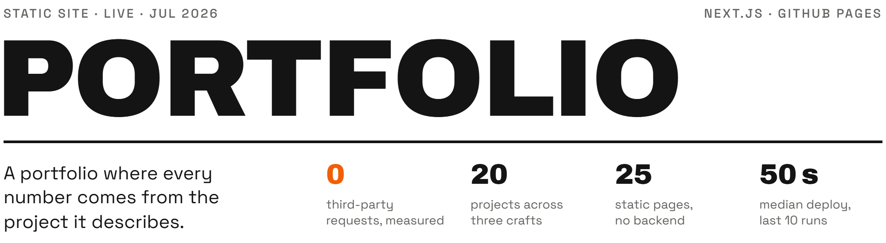
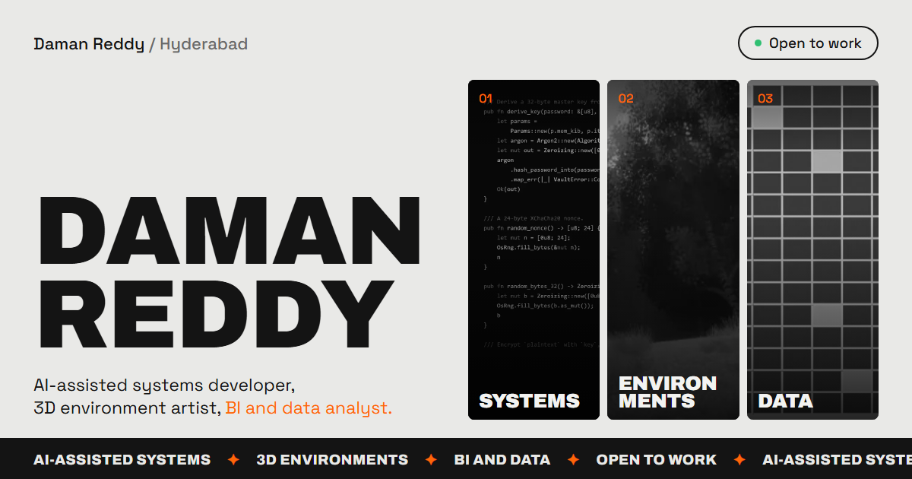

<picture>
  <source media="(max-width: 600px) and (prefers-color-scheme: dark)" srcset=".github/assets/header-phone-dark.png">
  <source media="(max-width: 600px) and (prefers-color-scheme: light)" srcset=".github/assets/header-phone-light.png">
  <source media="(prefers-color-scheme: dark)" srcset=".github/assets/header-dark.png">
  <source media="(prefers-color-scheme: light)" srcset=".github/assets/header-light.png">
  
</picture>

Daman Reddy's portfolio as a creative technologist in three crafts: AI-assisted systems developer, 3D environment artist, and BI and data analyst. It is a Next.js 16 static export on GitHub Pages, with every project, stat and pipeline card kept in one content file. It exists so each project can be judged on measured numbers rather than adjectives.

[Live site](https://damanjz.github.io/portfolio/) · [](https://github.com/damanjz/portfolio/actions/workflows/deploy.yml)

## Results

| Figure | Result | How it is produced |
|---|---|---|
| Third-party requests | 0 | Headless Chromium with network logging on 2026-10-12, load and full scroll of `/` (41 requests), `/projects/protec/` (44), `/data/` (55), `/projects/umbraixs/` (44): every request went to `damanjz.github.io` |
| Projects | 20, across three crafts | The `projects` array in `src/content.ts` (20 entries); 20 `/projects/` URLs in the live `sitemap.xml` |
| Static pages | 25 | `<loc>` entries in the live [sitemap.xml](https://damanjz.github.io/portfolio/sitemap.xml), 2026-10-12; no backend, no database |
| Deploy time | 50 s median (49.5 s), range 44 to 128 s | Push-to-live time of the last 10 `deploy.yml` runs on `main`, 2026-10-07 to 2026-10-09, `run_started_at` to `updated_at` from the GitHub Actions API |

## How it works

| Layer | Choice |
|---|---|
| Content | All copy, projects, stats and pipeline cards live in `src/content.ts`; components only lay it out |
| Framework | Next.js 16 (App Router), React 19, TypeScript, static export (`output: "export"`) |
| Styling | Plain CSS (`src/app/globals.css`), container-query sized cards; no Tailwind, no animation library |
| Motion | One shared layer (`src/components/Motion.tsx`): Lenis scroll, IntersectionObserver reveals, a single rAF loop for the wall |
| Type | Archivo 900 caps for display, Space Grotesk for text, self-hosted at build time via `next/font` |
| Deploy | Pushing to `main` runs `.github/workflows/deploy.yml`, which builds and publishes to GitHub Pages under the `/portfolio` base path (`NEXT_PUBLIC_BASE_PATH`) |

## Pages



- **Landing (`/`)**: a dossier. Who on the left: name, a short bio, the three crafts with one real stat each, and contact. Every project on the right, in three columns of tiles that drift slowly. Hover (or tab to) a craft and its work lights up on the wall; hover a work and its craft lights up and a line reads out what it is. A pause button stops the wall.
- **Craft pages**: [`/systems/`](https://damanjz.github.io/portfolio/systems/), [`/art/`](https://damanjz.github.io/portfolio/art/), [`/data/`](https://damanjz.github.io/portfolio/data/): the pitch, the numbers, how the work is done, then every project.
- **Project pages**: `/projects/<slug>/`: problem, build, measurement and findings, decisions, screenshots or renders, and links to source, live dashboards and case-study PDFs.
- **Resume**: [`/resume/`](https://damanjz.github.io/portfolio/resume/) with a PDF download.

Art and screenshots sit in black and white and come to colour on hover. Data and software projects without a strong screenshot are drawn as a pipeline card instead: what goes in, the core in orange, what comes out, and four measured numbers.

## Principles

- **Zero external requests.** Fonts are self-hosted at build time, images are committed WebP with 800/1400 px copies, and YouTube embeds (nocookie) load only on click.
- **Static and local-first.** No backend, no database, no analytics.
- **Real metrics only.** Every number on the site comes from the project it describes.
- **Works for everyone.** Keyboard parity for every hover, a pause control for motion, reduced motion respected, readable without JavaScript.
- **Machine-readable.** Per-page canonical, Open Graph and Twitter metadata, a site-wide `Person` schema, `sitemap.xml`, `robots.txt`, a semantic heading outline, and an [`llms.txt`](https://damanjz.github.io/portfolio/llms.txt) summary for language models.

## Quick start

Requirements: Node 22 (the version the deploy workflow uses) and npm.

```bash
npm ci
npm run dev                  # http://localhost:3000
npm run build                # static site in out/
npm run lint
node scripts/sizes.mjs       # after adding images: 800/1400 px WebP copies + manifest
CHROME=<path-to-chromium> node scripts/og.mjs   # after a build: refresh public/og.png
```

Check changes on the built `out/` folder rather than the dev server. Changes are listed in [CHANGELOG.md](CHANGELOG.md).

## Repo layout

```
src/
├── app/
│   ├── page.tsx                # landing (the dossier)
│   ├── [track]/page.tsx        # craft pages: systems, art, data
│   ├── projects/[slug]/        # one page per project
│   ├── resume/page.tsx         # resume page
│   ├── not-found.tsx           # custom 404 (out/404.html)
│   ├── sitemap.ts, robots.ts   # SEO routes
│   └── structured-data.tsx     # Person JSON-LD
├── components/
│   ├── Dossier.tsx             # landing: intro, crafts, drifting wall
│   ├── DataCard.tsx            # pipeline card
│   ├── WorkCard.tsx            # project card on craft pages
│   ├── Motion.tsx              # the one motion layer
│   └── ...                     # header, transitions, cursor, galleries
├── lib/asset.ts                # base-path aware asset URLs and srcset
└── content.ts                  # single source of truth
scripts/
├── sizes.mjs                   # 800/1400 px WebP copies + manifest
└── og.mjs                      # renders the share image (public/og.png)
.github/workflows/deploy.yml    # build and publish to GitHub Pages
```

## Limits

- No automated tests; `npm run build`, `npm run lint` and `npx tsc --noEmit -p .` are the checks.
- The zero-request figure covers four pages measured on 2026-10-12; a YouTube embed, once clicked, loads from youtube-nocookie.com.
- GitHub Pages caches HTML for about 10 minutes, so a fresh deploy can take that long to show.

## Licence

Code MIT; content (project copy, 3D art, images, video, and Daman's name and identity) all rights reserved. See [LICENSE](LICENSE).
